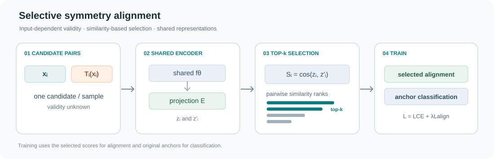
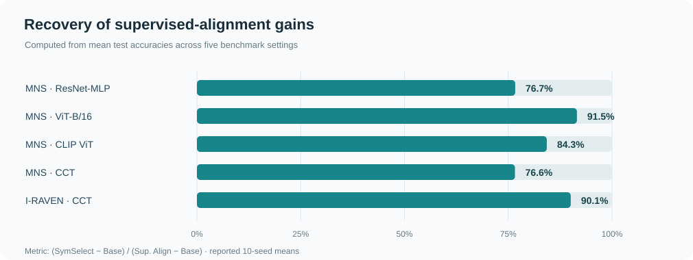

# 🔀 SymSelect: Recovering Symmetry Alignment When Validity Depends on the Sample

🌍 Languages: [English](README.md) | [中文](README_cn.md)

👉 TL;DR. The same transformation may preserve a label for some inputs but change it for others. **SymSelect** selects which candidate pairs to align using their representation similarity, recovering much of the benefit of supervised valid-pair alignment without knowing pair validity.

<p align="center">
  <b>📄 ICLR 2027 submission</b> &nbsp; | &nbsp;
  <a href="#-quickstart"><b>🚀 Quickstart</b></a> &nbsp; | &nbsp;
  <a href="#-demo"><b>🧪 Demo</b></a>
</p>

## 🎥 Overview

<p align="center">
  
</p>

**Figure 1.** For each input, SymSelect evaluates a candidate transformation, ranks the resulting pairs by cosine similarity, and aligns only the top-`k` pairs. Classification uses the original inputs.

---

## ✨ Highlights

- 🎯 **Input-dependent validity.** A structural transformation may preserve the target for one sample and change it for another.
- 🧮 **Selective alignment.** Rank projected cosine similarities within each mini-batch and align the top-`k` candidate pairs.
- 🧭 **Label-free selection.** Pair-validity labels are not needed to decide which pairs to align.
- 📈 **Oracle-gain recovery.** The paper reports 77%–92% recovery of the supervised-alignment improvement across the studied MNS and I-RAVEN settings.
- 🔬 **Beyond selection precision.** High validity precision alone does not ensure that the retained pairs preserve the oracle's beneficial gradient.
- ⚡ **Simple PyTorch core.** [`symselect.py`](symselect.py) works with any model that provides pairs of projected representations.

---

## 💡 Why SymSelect?

Swapping operands preserves the answer to `2 + 5` but changes the answer to `2 − 5`. Aligning every transformed pair introduces incorrect constraints; ignoring transformations entirely loses useful supervision.

SymSelect selects promising pairs using similarities computed by the model itself. Its analysis distinguishes the effects of invalid pairs from changes in the gradient caused by retaining only a subset of valid pairs.

---

## 📐 How SymSelect Works

For a mini-batch of original samples `x_i`, sample one candidate transformation `T_i` per sample. A shared backbone `f_θ` and projection head `E` produce

$$
z_i=E(f_\theta(x_i)),\qquad z'_i=E(f_\theta(T_i(x_i))).
$$

Rank the cosine similarities and select the largest `k`:

$$
S_i=\cos(z_i,z'_i),\qquad
\mathcal K=\operatorname{TopK}(S_1,\ldots,S_B;k).
$$

The optimization objective is

$$
L_{\mathrm{align}}=1-\frac{1}{k}\sum_{i\in\mathcal K}S_i,\qquad
L=L_{\mathrm{CE}}+\lambda_{\mathrm{align}}L_{\mathrm{align}}.
$$

🎯 **Selection.** The top-`k` indices are discrete, while gradients flow through the selected similarities.

🧩 **Supervision.** Cross-entropy is computed on the original samples. Only the chosen candidate pairs contribute to alignment.

⚙️ **Paper setting.** `B=64`, `k=6` and `λ_align=1`.

📏 **Theoretical condition.** With selected precision `ρ_k` and retained-valid gradient discrepancy `ε_sel`, a sufficient local condition for preserving the oracle's improvement is

$$
\mu_J>H_J\bigl(\epsilon_{\mathrm{sel}}+2(1-\rho_k)G\bigr).
$$

See [Method and Theory](docs/METHOD.md) for the quantities and assumptions, and [`demo/theory.py`](demo/theory.py) for an exact counterexample.

---

## 🔎 Comparison of Methods

| Method | How candidate transformations are used |
|---|---|
| Base | Original-sample classification only |
| Sym. Sample | Valid transformed examples receive supervised classification |
| Align All | Align every candidate pair |
| Random-`k` | Align `k` randomly sampled pairs |
| Bottom-`k` | Align the `k` lowest-similarity pairs |
| Validity-matched random-`k` | Match the selected valid/invalid composition, then randomize pair identities |
| Sup. Align | Align all truly valid candidate pairs, with validity supervision |
| 🔀 **SymSelect** | **Align the `k` highest-similarity pairs without validity supervision** |

---

## ⚙️ Install

Python 3.10 or newer:

```bash
git clone https://github.com/AtheavenMa/SymSelect.git
cd SymSelect
python -m pip install -e '.[demo,test]'
python -m pytest -q
```

---

## 🚀 Quickstart

```python
import torch
import torch.nn.functional as F
from symselect import symselect_loss

# Original samples, candidate transformations and original labels
x = torch.randn(64, 5)
x_t = x[:, [1, 0, 2, 3, 4]]
y = (x[:, 0] + x[:, 1] > 0).long()

backbone = torch.nn.Linear(5, 32)
classifier = torch.nn.Linear(32, 2)
projector = torch.nn.Sequential(
    torch.nn.Linear(32, 32), torch.nn.ReLU(), torch.nn.Linear(32, 16)
)

h, h_t = backbone(x), backbone(x_t)
loss_ce = F.cross_entropy(classifier(h), y)

selection = symselect_loss(projector(h), projector(h_t), k=6)
loss = loss_ce + selection.loss
loss.backward()

print("Selected pairs:", selection.indices.tolist())
print("Alignment loss:", selection.loss.item())
```

`symselect_loss` returns the loss, selected pair indices, all pair similarities and selected similarities.

👉 For a complete training example with a mixture of valid and invalid operand swaps, run [`demo/demo.py`](demo/demo.py).

---

## 📊 Main Results

**Test accuracy (%), mean ± standard deviation over 10 seeds**, as reported in the paper.

| Dataset | Backbone | Base | Sym. Sample | Sup. Align | 🔀 SymSelect |
|---|---|---:|---:|---:|---:|
| MNS | ResNet-MLP | 25.29±0.44 | 27.03±0.52 | 30.05±0.56 | **28.94±0.40** |
| MNS | ViT-B/16 | 22.78±0.34 | 24.33±0.27 | 27.63±0.23 | **27.22±0.39** |
| MNS | CLIP ViT-B/16 | 23.46±0.32 | 26.77±0.38 | 28.36±0.37 | **27.59±0.37** |
| MNS | CCT | 35.74±0.46 | 37.86±0.45 | 40.23±0.41 | **39.18±0.49** |
| I-RAVEN | CCT | 75.62±0.42 | 77.25±0.46 | 79.34±0.53 | **78.97±0.58** |

<p align="center">
  
</p>

**Figure 2.** Recovered supervised-alignment gain, computed from reported mean accuracies as `(SymSelect − Base) / (Sup. Align − Base)`.

**Validity-matched selector comparison (CCT):**

| Method | MNS accuracy | I-RAVEN accuracy |
|---|---:|---:|
| Random-`k` | 36.27±0.44 | 75.96±0.45 |
| Validity-matched random-`k` | 37.52±0.41 | 77.21±0.39 |
| 🔀 **SymSelect** | **39.18±0.49** | **78.97±0.58** |

SymSelect improves over validity-matched random-`k` by **1.66** points on MNS and **1.76** points on I-RAVEN. The compared methods have the same selected validity composition, isolating the effect of *which* pairs are selected.

---

## 🧪 Demo

👉 **Arithmetic transformations.** Generate arithmetic expressions, swap operands, and use a small shared neural network to select candidate pairs and perform a PyTorch gradient update.

```bash
python demo/demo.py
```

The demo saves a similarity-ranking plot, selected-pair examples and training diagnostics to `outputs/demo/`.

👉 **Theory counterexample.** Three candidate relationships show how a selector with 100% validity precision can still produce a worse local update direction than the full valid-pair oracle.

```bash
python demo/theory.py
```

See the [Demo Guide](docs/DEMO.md) for the commands and output descriptions.

---

## 🗺️ Figure Map

| Figure | Description |
|---|---|
| [Overview](assets/figures/overview.svg) | Candidate generation, similarity selection and training |
| [Recovery](assets/figures/recovery.svg) | Oracle-gain recovery across the five main settings |
| [Demo visualization](demo/demo.py) | Ranked candidate similarities and selected-pair validity |

---

## 🙏 Appreciation

We thank the creators of the MNS and I-RAVEN benchmarks and the research community developing structural generalization and representation learning.

## 📜 License

MIT. See [LICENSE](LICENSE).

