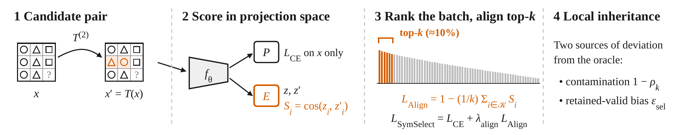
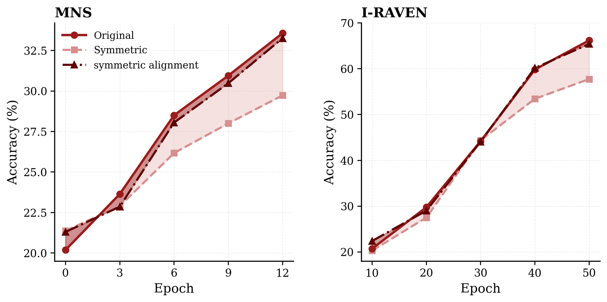
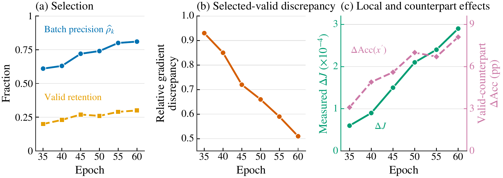

# 🎯 SymSelect: Learning Which Transformations to Trust for Systematic Reasoning

🌍 Languages: [English](README.md) | [中文](README_cn.md)

👉 TL;DR. A transformation can preserve a label for one sample but change it for another. **SymSelect** learns which candidate pairs to align from their representation similarity, recovering much of the benefit of supervised valid-pair alignment without knowing pair validity. The core is [one PyTorch file](symselect.py), with runnable [arithmetic](demo/demo.py) and [theory](demo/theory.py) demos.

<p align="center">
  <b>📄 arXiv paper coming soon</b> &nbsp; | &nbsp;
  <a href="#-quickstart"><b>🚀 Quickstart</b></a> &nbsp; | &nbsp;
  <a href="#-demo"><b>🧪 Demo</b></a>
</p>

## 🎥 Overview

<p align="center">
  
</p>

**Figure 1.** SymSelect creates one candidate transformation per sample, scores each pair using projected cosine similarity, and aligns the top-`k` pairs within the mini-batch. Selected updates can differ from the valid-pair oracle through invalid-pair contamination and retained-valid bias.

---

## ✨ Highlights

- 🎯 **Input-dependent validity.** The same structural transformation can preserve some labels while changing others.
- 🧮 **Selective alignment.** One cosine score per candidate pair, with top-`k` selection across the mini-batch.
- 🧭 **No validity labels.** Selection uses projected representations rather than ground-truth transformation validity.
- 📈 **Oracle-gain recovery.** Across MNS and I-RAVEN settings, SymSelect recovers **77%–92%** of the supervised-alignment gain.
- 🔬 **Two sources of deviation.** The analysis separates invalid-pair contamination from bias among the valid pairs that remain selected.
- ⚡ **Small core, runnable demo.** [`symselect.py`](symselect.py) provides the objective in PyTorch; the demos show selection, gradients, and a theoretical counterexample.

---

## 💡 Why SymSelect?

Swapping the operands of `2 + 5` preserves the answer, but swapping those of `2 − 5` changes it. Aligning every transformed pair imposes incorrect constraints; ignoring the transformations wastes useful structural supervision. Supervised alignment can use validity labels to avoid this problem, but those labels are generally unavailable.

SymSelect uses similarity between projected representations as an observable selection signal. The central question is **how much of the benefit of valid-pair alignment can be retained without observing which pairs are valid?**

---

## 📐 What SymSelect Computes

🎯 **Candidate pairs.** For each original input $x_i$, sample one candidate transformation $T_i$ and compute representations using a shared backbone $f_\theta$ and projection head $E$:

$$
z_i = E(f_\theta(x_i)),\qquad z_i' = E(f_\theta(T_i(x_i))).
$$

🧮 **Similarity selection.** Score and rank all $B$ candidate pairs within the mini-batch:

$$
S_i=\cos(z_i,z_i'),\qquad \mathcal K=\mathrm{TopK}(S_1,\dots,S_B;k).
$$

🧩 **Alignment objective.** Only selected pairs contribute to the alignment term; classification uses the original anchors:

$$
L_{\mathrm{align}}=1-\frac{1}{k}\sum_{i\in\mathcal K}S_i,\qquad
L_{\mathrm{SymSelect}}=L_{\mathrm{CE}}+\lambda_{\mathrm{align}}L_{\mathrm{align}}.
$$

⚙️ **Implementation.** Top-`k` indices remain fixed during differentiation, while gradients flow through the selected cosine scores. The paper uses $B=64$, $k=6$, and $\lambda_{\mathrm{align}}=1$.

📏 **Local inheritance.** Let $\rho_k$ measure selected validity precision and $\epsilon_{\mathrm{sel}}$ the gradient discrepancy among retained valid pairs. Under the paper's smoothness and step-size conditions, a sufficient condition for inheriting the oracle's local benefit is

$$
\mu_J > H_J\bigl(\epsilon_{\mathrm{sel}}+2(1-\rho_k)G\bigr).
$$

Even perfect selected validity does not eliminate $\epsilon_{\mathrm{sel}}$. See [Method & Theory](docs/METHOD.md) and the [exact example](demo/theory.py).

---

## 🔎 Comparison of Methods

The comparisons use the same candidate transformation family but differ in how the transformed pairs are used.

| Method | Candidate-pair treatment | Needs validity labels? |
|---|---|:---:|
| Base | Original-sample classification only | No |
| Sym. Sample | Classify valid transformed samples; no alignment term | Yes |
| Align All | Align every candidate pair | No |
| Random-`k` | Align a random set of `k` candidate pairs | No |
| Bottom-`k` | Align the `k` lowest-similarity pairs | No |
| Validity-matched random-`k` | Preserve the selected valid/invalid counts and randomize pair identity | Yes |
| Sup. Align (oracle) | Align all truly valid candidate pairs | Yes |
| **SymSelect** | **Align the top-`k` pairs by projected cosine similarity** | **No** |

---

## ⚙️ Install

Use Python 3.10 or newer.

```bash
git clone https://github.com/AtheavenMa/SymSelect.git
cd SymSelect
python -m pip install -e '.[demo,test]'
python -m pytest -q
```

[`symselect.py`](symselect.py) depends only on PyTorch; the demo additionally uses Matplotlib.

---

## 🚀 Quickstart

```python
import torch
import torch.nn.functional as F
from symselect import symselect_loss

# One candidate transformation for each original input
x = torch.randn(64, 5)
x_t = x[:, [1, 0, 2, 3, 4]]
y = (x[:, 0] + x[:, 1] > 0).long()

backbone = torch.nn.Linear(5, 32)
classifier = torch.nn.Linear(32, 2)
projector = torch.nn.Linear(32, 16)

h, h_t = backbone(x), backbone(x_t)
loss_ce = F.cross_entropy(classifier(h), y)  # original inputs only
selection = symselect_loss(projector(h), projector(h_t), k=6)
loss = loss_ce + selection.loss
loss.backward()

print(selection.indices.tolist())
print(selection.loss.item())
```

`selection` also contains the full cosine scores and the selected scores. See the [Demo Guide](docs/DEMO.md) for a complete training example.

👉 Run the offline arithmetic demo:

```bash
python demo/demo.py
```

---

## 📊 Main Results

**Accuracy (%), mean ± standard deviation over 10 seeds.** SymSelect approaches the supervised valid-pair oracle across four MNS backbones and CCT on I-RAVEN.

| Dataset | Backbone | Base | Sym. Sample | Sup. Align | SymSelect |
|---|---|---:|---:|---:|---:|
| MNS | ResNet-MLP | 25.29±0.44 | 27.03±0.52 | 30.05±0.56 | **28.94±0.40** |
| MNS | ViT-B/16 | 22.78±0.34 | 24.33±0.27 | 27.63±0.23 | **27.22±0.39** |
| MNS | CLIP ViT-B/16 | 23.46±0.32 | 26.77±0.38 | 28.36±0.37 | **27.59±0.37** |
| MNS | CCT | 35.74±0.46 | 37.86±0.45 | 40.23±0.41 | **39.18±0.49** |
| I-RAVEN | CCT | 75.62±0.42 | 77.25±0.46 | 79.34±0.53 | **78.97±0.58** |

For CCT, the recovered Base-to-oracle gain is **77% on MNS** and **90% on I-RAVEN**. Across the listed settings, recovery ranges from 77% to 92%.

<p align="center">
  
</p>

**Figure 2.** Original and valid-counterpart accuracy during training on MNS and I-RAVEN. Base training develops a counterpart gap, while supervised valid-pair alignment reduces it.

#### 🎯 Matched selector controls

| Selector | MNS precision / retention | MNS accuracy | I-RAVEN precision / retention | I-RAVEN accuracy |
|---|:---:|---:|:---:|---:|
| Random-`k` | .28 / .10 | 36.27±0.44 | .29 / .08 | 75.96±0.45 |
| Validity-matched random-`k` | .74 / .23 | 37.52±0.41 | .81 / .29 | 77.21±0.39 |
| **SymSelect** | **.74 / .23** | **39.18±0.49** | **.81 / .29** | **78.97±0.58** |

Even at matched selected validity composition, SymSelect improves test accuracy by **1.66** points on MNS and **1.76** points on I-RAVEN.

#### 🔬 Selector dynamics and local improvement

<p align="center">
  
</p>

**Figure 3.** Along one I-RAVEN trajectory, selected validity precision increases, the retained-valid gradient discrepancy decreases, and the selected alignment step improves the measured diagnostic. These complementary measurements connect selector behavior to local optimization.

See [complete numerical results](docs/PAPER_RESULTS.md) for additional controls and [Figure Map](docs/FIGURE_MAP.md) for the original manuscript figures.

---

## 🧪 Demo

👉 **Arithmetic selection.** A small PyTorch model learns from synthetic arithmetic expressions, ranks their operand-swap pairs, then performs a classification-plus-alignment gradient update.

```bash
python demo/demo.py
python demo/demo.py --seed 2 --batch-size 64 --k 6
```

The demo saves `selection.png`, `pairs.json`, and `metrics.json` in `outputs/demo/`. Pair validity is evaluated for diagnostics after selection.

👉 **Local theory counterexample.** Run a three-pair construction in which selected validity precision is 100%, but the selected and oracle alignment directions have opposite first-order effects.

```bash
python demo/theory.py
# selected first-order effect: -1
# valid-pair oracle first-order effect: +1
```

---

## 🗺️ Figure Map

| Figure | Description |
|---|---|
| [Figure 1](assets/figures/fig1.png) | Candidate pairs, projected similarity, top-`k` alignment, and local inheritance |
| [Figure 2](assets/figures/fig2.png) | Accuracy on original samples and valid transformed counterparts |
| [Figure 3](assets/figures/fig3.png) | I-RAVEN selector dynamics and local alignment effects |
| [Supplementary figure](assets/figures/fig4.png) | Symmetric counterparts versus matched random augmentation on MNS |

---

## 🙏 Appreciation

We thank the creators of the MNS and I-RAVEN benchmarks and the wider representation-learning community.

📄 **Paper.** *SymSelect: Learning Which Transformations to Trust for Systematic Reasoning*. arXiv paper coming soon.

## 📜 License

[MIT License](LICENSE).
